# Qué ve cada cuenta – ejemplos

Capturas tomadas de la web de demostración. Para repetirlas, entra con el usuario indicado
(botón **«Cambiar de usuario»** en la barra amarilla). Si hiciste pruebas antes, usa primero **«Restablecer datos de ejemplo»**.

Las personas son ficticias. Lo importante es la regla: **cada capacitación la ven solo sus responsables**, aunque otra persona también sea Administrador RR.HH.

| Cuenta | Rol en el portal | Responsable de… | Ve en «Capacitaciones» |
|---|---|---|---|
| Nicole Alejandro | Admin RR.HH. | Propietaria de Inducción INVA, Charla SST, Seguridad de la información, Beneficios 2026 y Código de Ética (borrador) | Esas 5 |
| Carla Mendoza | Admin RR.HH. | Editora de Inducción INVA | Solo Inducción INVA |
| Jorge Ramírez | Admin RR.HH. (jefe) | Propietario de Inducción HC | Solo Inducción HC |
| Lucía Torres | Admin RR.HH. | Editora de Inducción HC | Solo Inducción HC |
| Renzo Castillo | Colaborador | Solo lectura de Charla SST | Solo Charla SST (sin botones de cambio) |
| Diego, Andrés, María… | Colaborador | — | No tienen el menú de administración |

Todas las personas, sean de RR.HH. o no, tienen además **«Mis Capacitaciones»** con las capacitaciones que les asignaron.

---

## 1. Nicole – Administradora RR.HH. y propietaria

**Dashboard.** Solo cuenta las capacitaciones de las que es responsable.

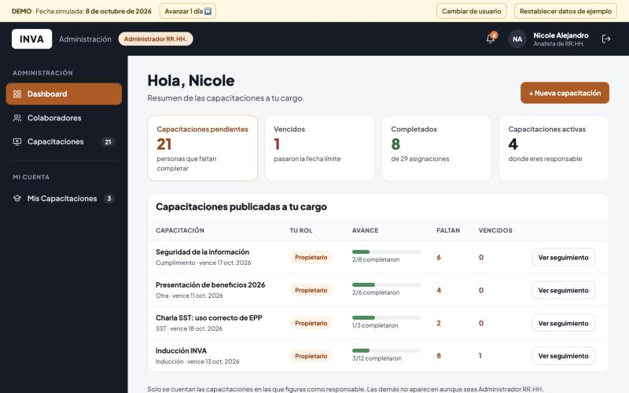

**Capacitaciones.** Ve las 5 de las que es propietaria, incluida la que está en borrador. **No ve «Inducción HC»**, que es de Jorge.

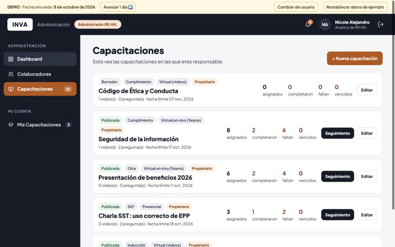

**Seguimiento.** Como propietaria puede hacer todo: enviar recordatorios, exportar, descargar el registro y editar.

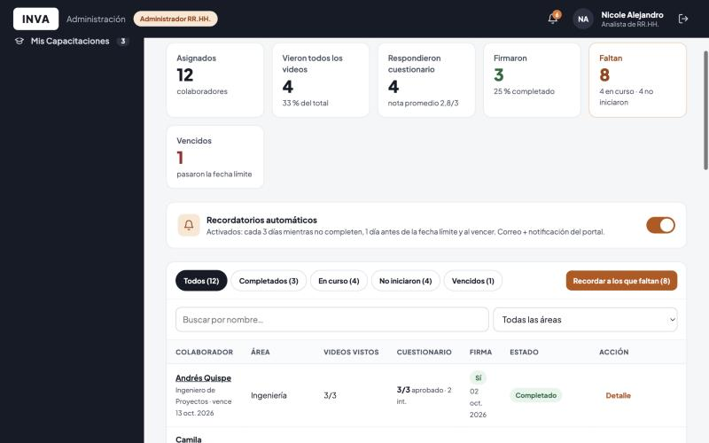

**Subir la lista de Teams.** En «Presentación de beneficios 2026» sube el archivo de asistencia de Teams. El portal reconoce a cada persona y le muestra la lista antes de registrar.

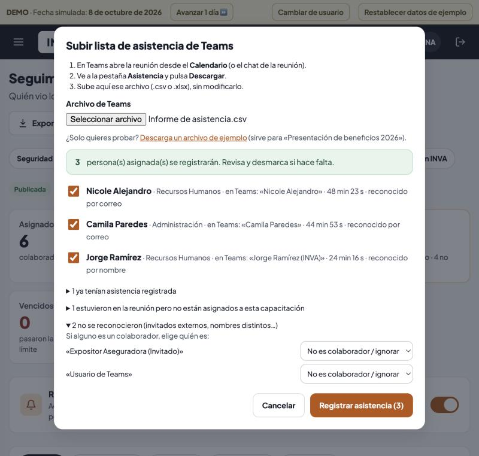

---

## 2. Jorge – Jefe de RR.HH., pero NO responsable de la Inducción INVA

**Capacitaciones.** Solo aparece la que él creó. Ser jefe de RR.HH. **no** le da acceso a las demás.

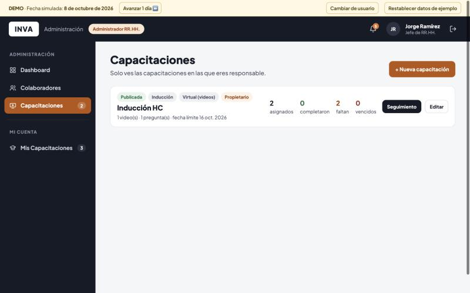

**Si intenta entrar por el enlace directo** al seguimiento de la Inducción INVA, el portal le responde «403 No tienes acceso». El intento queda en el historial de cambios de esa capacitación.

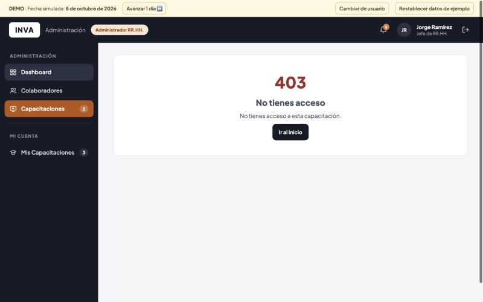

---

## 3. Carla – Editora de la Inducción INVA

Puede ver el seguimiento, editar la capacitación y enviar recordatorios. **No puede cambiar a los responsables**: eso solo lo hace un propietario. Abajo se ve el historial de cambios, incluido el intento de acceso de Jorge.

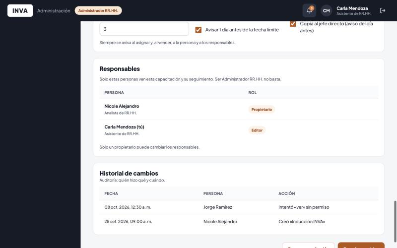

---

## 4. Renzo – Colaborador con acceso de solo lectura a la Charla SST

Es supervisor SST, así que puede **ver** el seguimiento, exportar a Excel y descargar el registro de asistencia. No tiene botones para enviar recordatorios ni para editar.

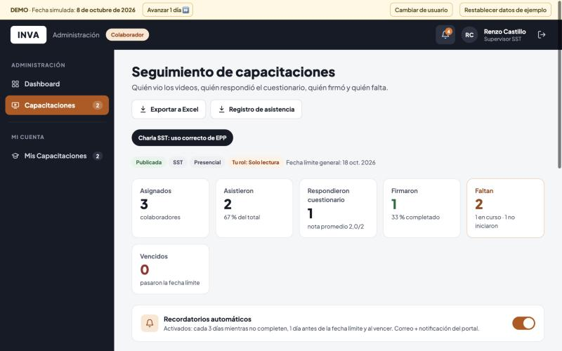

---

## 5. Diego – Colaborador

**Mis Capacitaciones.** Ve solo las suyas: la Inducción en curso y la Charla SST ya completada. No tiene menú de administración.

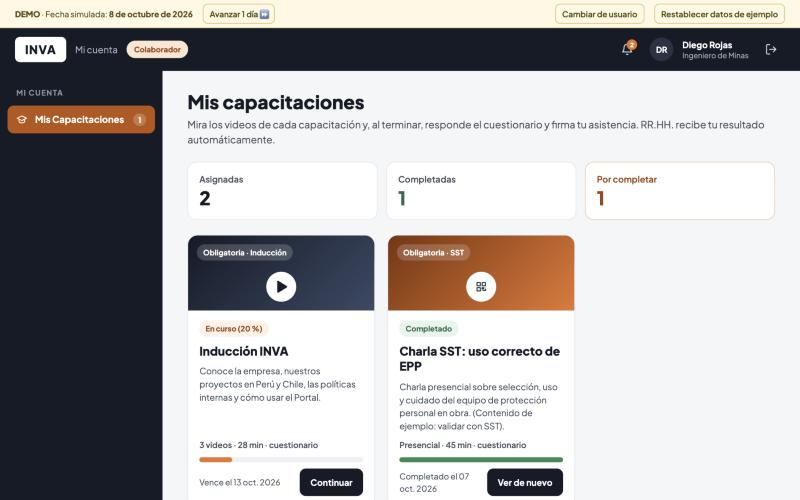

**Reproductor.** Ve los videos en orden. No puede adelantar más de lo que ya vio, y los pasos siguientes están bloqueados (candado) hasta que termine los anteriores.

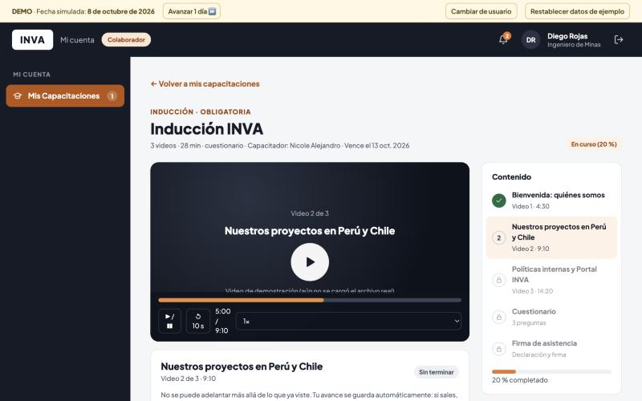

**Si intenta abrir una pantalla de RR.HH.** con el enlace directo, el portal se lo bloquea.

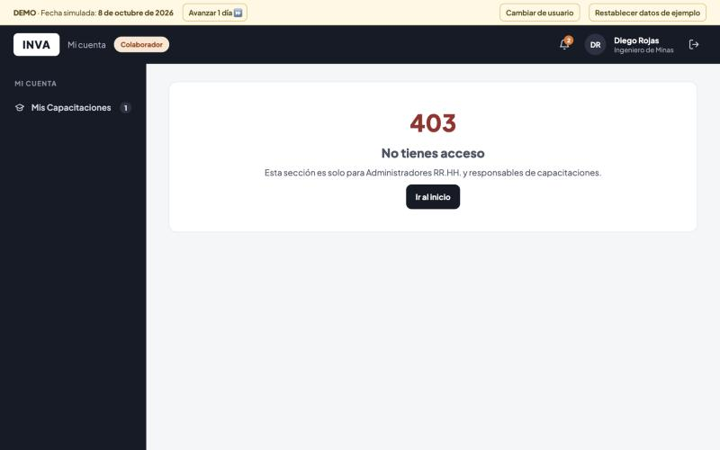

---

## 6. Lucía – Asignada a una reunión de Teams sin cuestionario

Entra a la reunión desde la invitación de Teams. En el portal no tiene que hacer nada: RR.HH. registra su asistencia, a mano o subiendo la lista de Teams.

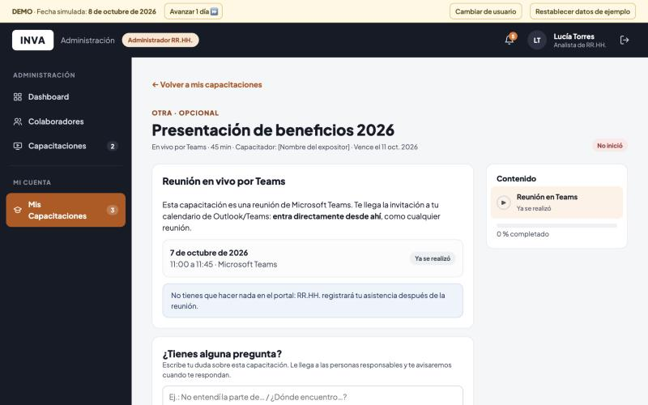
